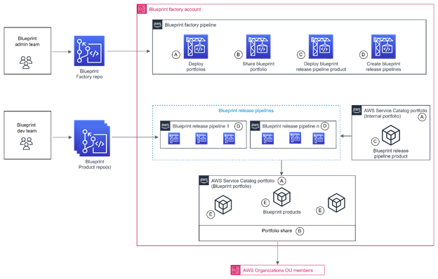
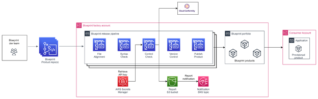

# Driving Enterprise Service Catalog with DevOps mindset and tools
## Description

This solution that will streamline the validation, publishing, distribution, and consumption of infrastructure-as-code (IaC), secure-by-design blueprints. In addition to the capability to integrate automated controls and programmatic configurations such as cfn-nag, this solution simplifies the consumption of blueprint across AWS Organizations by removing dependency on legacy human-dependent processes which reduce the blueprint consumption lead time from days to seconds.

## Getting Started

### Two main components of this solution are:

* Blueprint factory
* Blueprint release pipeline

#### Blueprint factory overview

Figure 1 shows the Blueprint factory pipeline architecture.



This is a config-driven architecture, and the config file is stored in Blueprint factory repo. This config file consists of Service Catalog portfolios and products. Once a Blueprint template is completed, the Blueprint developer will update the product details in the config file. This will trigger the Blueprint Factory pipeline. Below are the different stages of Blueprint factory pipeline.

Stage A – Deploy portfolios: If you are triggering the pipeline for the first time, it’ll start with deploy portfolio stage. At this stage the pipeline deploys two portfolios, one Internal portfolio and one Blueprint portfolio. The products that are managed by Blueprint Factory Admin team are associated with Internal portfolio. One example of an internal product is Blueprint release pipeline that is used to deploy the Blueprints as Service Catalog products. We will talk more about this pipeline as we unveil further steps in the architecture. 

Stage B – Share blueprint portfolio: In the next stage of Blueprint factory pipeline, the Blueprint portfolio is shared with AWS Organizations Units. This will enable consumer accounts that are OU members to seamlessly consume the Blueprint products that are associated with Blueprint portfolio.

Stage C – Deploy blueprint release pipeline product: In this stage, the pipeline will fetch Blueprint release pipeline stack from the Blueprint factory CodeCommit repo and deploys it as a Service Catalog product. This product is then associated with the Internal portfolio that is created in Stage A. This will help us with the version control of the Blueprint release pipeline stack. 

Stage D – Create blueprint release pipelines: In stage D, based on the product details updated in the config file, factory pipeline will prepare the stack parameters and will provision the Blueprint product release pipeline product from Service Catalog. This will launch Cloudformation stack of Blueprint product release pipeline which in turn will create the pipeline for the Blueprint product (we will discuss about the various stages of Blueprint product release pipeline in the next section). After successful execution of all stages, release pipeline will deploy the Blueprint as Service Catalog product and associate it with Blueprint Portfolio. Since this portfolio is shared with Organization Units, Blueprint product is now available for consumer accounts for consumption.

#### Blueprint release pipeline overview

Figure 2 shows the Blueprint release pipeline architecture.



A single blueprint development follows GitOps flow, that means its developed and uploaded to a feature branch and a pull request is submitted for review. Once its reviewed and approved after peer review and cyber review process, its merged into a master branch. This will then trigger Blueprint release pipeline. 
In the first stage, the template is checked for file alignment. The pipeline accepts both cloudformation and cdk formats. If the file is a cdk construct, it will be synthesised to a cloudformation template. Second stage will perform syntax check of the template using cfn-lint. In the next stage, the pipeline runs cfn-nag to check the template against security rules; the stage fails if cfn-nag reports a failure. You can add other policy-as-code checks (for example, AWS CloudFormation Guard) as additional stages. In the next two stages, pipeline will deploy the new version of the product and it’ll also perform version control. When there is an update in the blueprint template and bump up in the version, pipeline version control stage will make older versions of the product inactive.

### Dependencies

* AWS accounts.
* AWS Organizations set up in case of  Multi-Accounts with Management-Tenant model.
* Access to CloudFormation  and permissions to deploy a CloudFormation stack with the ability to  create the following resources: AWS CodeConnections - coneciton to your git repositories, AWS CodePipeline  - Code pipelines, AWS CodeBuild - CodeBuild projects, AWS  Service Catalog - Portfolios, Products and Provisioned products, AWS  Systems Manager - Parameter store, Amazon CloudWatch Log Group  - CloudWatch Log group, Amazon S3 - S3 buckets, Amazon  EventBridge – EventBusPolicy and Rule, Amazon SNS – Topic,  TopicPolicy and Subscription, AWS KMS – Key and KeyPolicy, and AWS  IAM – Role and Policy.

### Installing

* Clone repositories into Github
Please adjust the method, hostname and destination repo name/group to suit your git provider
```
git clone git@github.com:aws-samples/aws-enterprise-blueprint-factory-blueprint-repo.git ServiceCatalog-BlueprintProductRepo
git clone git@github.com:aws-samples/aws-enterprise-blueprint-factory-config-repo.git ServiceCatalog-ConfigRepo
git clone git@github.com:aws-samples/aws-enterprise-blueprint-factory-code-repo.git ServiceCatalog-CodeRepo
cd ServiceCatalog-ConfigRepo
git remote rename origin origin-public
git remote add origin git@github.com:ServiceCatalog-ConfigRepo
git push origin main
cd ../ServiceCatalog-CodeRepo
git remote rename origin origin-public
git remote add origin git@github.com:ServiceCatalog-CodeRepo
git push origin main
cd ../ServiceCatalog-BlueprintProductRepo
git remote rename origin origin-public
git remote add origin git@github.com:ServiceCatalog-BlueprintProductRepo
git push origin main
```

### IAM roles

`ServiceCatalog-Pipeline.yml` creates every IAM role the Blueprint Factory needs. You don't need to create a CodeBuild or Service Catalog admin role manually, and you don't need to edit any trust policies. Each role trusts only one AWS service, and only on behalf of the account the stack is deployed in (`aws:SourceAccount`):

| Role | Trusted service | Purpose |
|---|---|---|
| `CodeBuildServiceRole` | `codebuild.amazonaws.com` | Runs the Portfolio, Portfolio-shares, Product, and Product-tenant scripts. It manages Service Catalog portfolios and products, reads and writes `/blueprints/*` SSM parameters, and can pass only the launch constraint roles to Service Catalog. |
| `BootstrapLaunchRole` | `servicecatalog.amazonaws.com` | The launch constraint role for `Bootstrapping-Admin-Product`. Service Catalog assumes it to provision the blueprint release pipeline (`Product/bp-pipeline/bp-pipeline.yaml`). It can manage only resources whose names start with `SC-` (Service Catalog provisioned stacks), `BluePrint_` pipelines, and `/blueprints/*` parameters. |
| `CleanupFunctionRole` | `lambda.amazonaws.com` | Removes the admin product and portfolio when the stack is deleted. |
| `rTransformExecutionRole` | `lambda.amazonaws.com` | Runs the `ReplicateWith` CloudFormation macro. |
| `CodePipelineServiceRole` | `codepipeline.amazonaws.com` | Runs `ServiceCatalog-Pipeline`. |

Blueprint products are launched with the role set in `launch_contraint_role` in `bp_config.yml`. Create that role yourself, and grant it only the permissions that the blueprint's resources need. Set the `BlueprintLaunchRoleNamePattern` stack parameter to its name (default `ServiceCatalogLaunchConstraintRole*`) so the pipeline can attach it to products as a launch constraint.

The person deploying `ServiceCatalog-Pipeline.yml` needs permissions to create the resources listed in [Dependencies](#dependencies), including IAM roles and policies. After deployment, day-to-day changes go through the config and blueprint repositories and don't require any IAM permissions.

### Upgrading an existing deployment

If you deployed an earlier version of this solution:

* The `IamRoleName` parameter has been removed. After you update the stack, the pipeline uses the roles described above. You can delete the role that you created manually (default `codebuild-servicecatalog-admin-role`) once the pipeline has run successfully.
* The existing launch constraint on `Bootstrapping-Admin-Product` still references the old role. In the Service Catalog console, open `Bootstrapping-Admin-Portfolio`, select **Constraints**, and edit the launch constraint so that it uses the `BootstrapLaunchRole` created by the stack.
* The stack now creates the log groups `/aws/lambda/<stack-name>-replication-macro` and `/aws/lambda/<stack-name>-admin-product-portfolio-cleanup`. If either already exists, delete it before you update the stack.
* The Lambda function and CodeBuild network interface permissions are scoped to resources in the stack's account and Region. If your subnets are shared with you from another account (VPC sharing), add that account's subnet ARNs to the `ManageFunctionNetworkInterfaces` and `ManageBuildNetworkInterfaces` statements.

### Cleanup

* Remove all the Service Catalog products
```
* Comment all products in bp_config.yml
* Commit and push to ServiceCatalog-ConfigRepo
```

* Remove all the Service Catalog portolios
```
* Comment all portfolios in bp_config.yml
* Commit and push to ServiceCatalog-ConfigRepo
```

* Delete the `ServiceCatalog-Pipeline` CloudFormation stack. Do this last: the stack deletes `BootstrapLaunchRole`, and Service Catalog needs that role to terminate the blueprint release pipelines it provisioned.

## Authors

Joe Guo
[@guojing1217](https://github.com/guojing1217)

Shreejesh MV
[@shreejeshmv](https://github.com/shreejeshmv)

Haofei Feng
[@haofeif](https://github.com/haofeif)

Cam Maxwell
[@cmaxwellau](https://github.com/cmaxwellau)


## Version History

* 0.1
    * Initial Release

## Disclaimer

This is sample code, for non-production usage. It is provided as-is, without warranty of any kind. Review and test it, and work with your security and legal teams to meet your organization's security, regulatory, and compliance requirements, before you deploy it in a production environment. Deploying this solution creates AWS resources that incur charges in your AWS account.

## Security

See [CONTRIBUTING](CONTRIBUTING.md#security-issue-notifications) for more information.

## License

This library is licensed under the MIT-0 License. See the LICENSE file.

## Acknowledgments

Inspiration, code snippets, etc.
* [cfn-lint](https://github.com/aws-cloudformation/cfn-lint)
* [cfn-nag](https://github.com/stelligent/cfn_nag)
